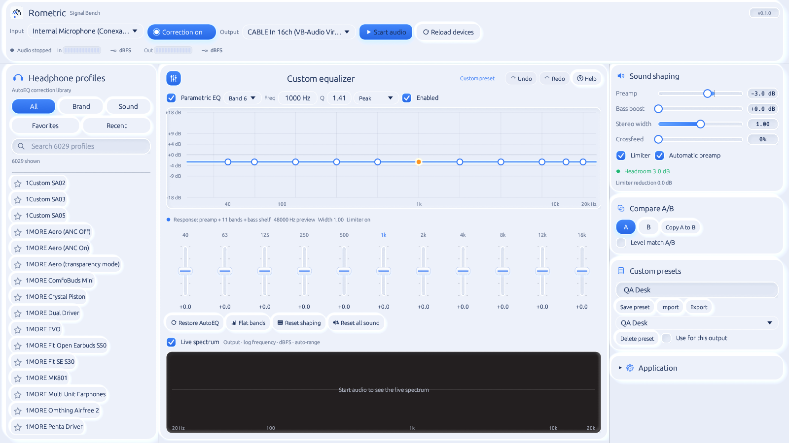

# Rometric

[](https://github.com/Romailahmadbutt/rometric/releases/latest)
[](LICENSE)


A native Windows equalizer built from a decompilation study of the Android app
**Wavelet** (`com.pittvandewitt.wavelet` 26.05). It carries over the parts that
make sense on a desktop: the full AutoEQ profile database, the 11-band
correction curve, preamp, bass boost and a limiter.

It is an independent Rust implementation. It shares no code with Wavelet and is
not affiliated with its author.



---

## What was carried over

The Android app's pipeline, as established from the shipped APK, is:

```
session broadcast → per-session DynamicsProcessing (11-band pre-EQ,
preamp/input gain, MBC, limiter) + legacy BassBoost/Reverb/Virtualizer
```

| Wavelet feature | Evidence in the APK | Status here |
|---|---|---|
| 6,029 AutoEQ profiles | `auto_eq.db`, `SELECT headphone, equalization …` | **Included** (pre-packed, searchable) |
| AutoEQ curve → 11 bands | `b6.y.b` resampled onto `{0, 62.5 … 24k}` Hz | **Included** (`src/dsp.rs`) |
| Preamp / input gain | `setInputGainbyChannel` | **Included** |
| Limiter | `setLimiterAllChannelsTo` | **Included** (stereo-linked peak limiter) |
| Bass boost | legacy `BassBoost`, SDK 28 only | **Included** as a low shelf at 80 Hz |
| DynamicsProcessing MBC | `setMbcAllChannelsTo` | **Not included** — no multiband compressor was configured by default |
| Virtualizer | legacy `Virtualizer` | **Approximated** by a mid/side stereo-width control |
| Preset / environmental reverb | legacy effects | **Not included** (Android-specific) |
| Per-session routing | one `n0` per audio session | **Replaced** by device routing (see below) |
| Session state indicator | `b6.b1` aggregated flags | **Replaced** by the status line |

### Why routing is different

Wavelet attaches an `AudioEffect` to another app's audio session through
Android's `OPEN_AUDIO_EFFECT_CONTROL_SESSION` broadcast. Windows has no
user-mode equivalent: an application cannot attach a DSP to another
application's stream without a kernel audio processing object (APO), which
requires a signed driver install.

So this build processes **one device stream**: it captures a device, runs the
EQ, and renders to another. With a virtual audio cable as the default playback
device, that covers every application on the machine.

---

## System-wide setup (no admin rights)

1. Install a virtual audio cable such as **VB-CABLE**.
2. Windows **Settings → System → Sound**: set the cable's playback device as
   the default output.
3. Launch `rometric.exe`.
4. Set **Capture** to the cable's output (e.g. `CABLE Output`) and **Output** to
   your headphones/DAC.
5. Press **Start audio**. Every app's sound now passes through the EQ.

To process only one application, point that application at a second cable and
run a second copy of the app against it.

> Realtime audio needs a small buffer. If you hear crackles, raise the process
> priority of `rometric.exe` or switch the cable to 48 kHz.

---

## Using it

- **Search** the 6,029-profile AutoEQ database and click a headphone. Its
  correction curve is mapped onto the 11 sliders and, with *Auto preamp*
  enabled, the preamp is set so the curve cannot clip.
- **Browse by category**. The library can be shown as one list (*All*), as
  folders per manufacturer (*Brand*), or as folders describing what each
  correction does to the sound (*Sound*). *Favorites* and *Recent* stay as
  personal lists. The chosen view is remembered between launches.
- **Sliders** are ±12 dB. Band 0 is a low shelf at 40 Hz, bands 1–9 are
  peaking filters, band 10 is a high shelf at 16 kHz.
- **Bass boost** is an independent low shelf (0–15 dB).
- **Stereo width** is the stand-in for the legacy Virtualizer (1.0 = unchanged).
- **Limiter** keeps the output below 0 dBFS; leave it on.
- Settings persist to `%APPDATA%\Rometric\config.json`. Existing settings from
  `%APPDATA%\wavelet-win\config.json` are imported automatically.

### Profile categories

The shipped asset only contains a profile name and a 127-point correction
curve, so the categories are derived from exactly that data:

- **Brand** is the manufacturer prefix of the name. A curated list keeps
  multi-word brands whole (`64 Audio`, `Bowers & Wilkins`, `Astell & Kern`,
  `Queen of Audio`); everything else uses its first word. Brands that appear
  once are collated into a final *Other brands* folder so the tree stays
  navigable — on the shipped library that is 437 brand folders.
- **Sound** describes what the correction does to the signal, not how a
  headphone is marketed. The mean gain over 20–200 Hz (bass), 300–2,000 Hz
  (mids) and 4,000–10,000 Hz (treble) is computed; the strongest region wins and
  anything under 1 dB becomes *Neutral correction*. The seven buckets are
  fixed so the folders never reorder between launches.

Search narrows inside the current arrangement and opens matching folders.

### Signal Bench interface

The desktop interface uses a light Soft UI design system: softly raised cards,
recessed inputs and graph surfaces, blue gradient active states, inset fader
tracks, rounded controls and restrained dual shadows. The layout remains
responsive: profiles stay beside the equalizer where space permits, while the
inspector scrolls independently and compact navigation replaces crowded columns
in narrow or highly scaled windows.

The interface is organized around the complete audio path rather than
individual settings pages:

- The routing strip keeps capture, correction/bypass, output, stream state and
  input/output meters visible together.
- The response graph supports direct band dragging, keyboard adjustment and
  double-click band reset. It uses the active output sample rate.
- Profiles can be searched, favorited and reopened from a recent list.
- Profiles are also grouped: one folder per brand (single-profile brands are
  collated into *Other brands*) or one folder per kind of correction — *Adds
  bass*, *Cuts bass*, *Adds mids*, *Cuts mids*, *Adds treble*, *Cuts treble* and
  *Neutral correction*.
- Complete sound setups can be saved as custom presets, imported/exported as
  validated JSON, compared in A/B slots and assigned to an output device.
- Undo/redo, scoped resets, predicted headroom and limiter gain reduction make
  experimentation safer.
- Audio diagnostics report stream format, queue health, processed frames and
  recent errors. Missing devices can reconnect automatically.
- Live spectrum is controlled below the equalizer. Reduced-motion mode,
  close-to-tray behavior and per-user Windows startup remain in Application.

### Parametric editing and spectrum

The centre card still contains the same eleven faders and response graph.
Enable **Parametric EQ** above the graph to edit the selected band's frequency,
gain, Q, filter type (*Peak*, *Low shelf*, *High shelf*) and Enabled state. Select
a band through its label, fader, graph point or band selector. Turning the mode
off uses the original graphic mapping; **Restore AutoEQ** restores the selected
headphone's original fixed-band mapping.

**Live spectrum** now lives below the faders and reset actions inside that same
card, rather than appearing as a second component or duplicate graph overlay.
It shows real output audio as mirrored rainbow dots on a logarithmic frequency
axis. The picture auto-ranges for quiet audio; hover readouts remain absolute
dBFS. The mirror is visual, not separate left/right channels. Stopped audio and
silence produce no colored bars. Reduced-motion mode is respected.

The existing input/output meters also show numeric sample peaks in dBFS:
0 dBFS is full scale, and silence is −∞. This is not an acoustic listening-level
or true-peak measurement.

### Crossfeed, A/B matching and preset safety

**Crossfeed** is part of the existing Sound shaping card. It feeds low-frequency
information toward the other ear while preserving mono; 0% is off. It is not a
replacement for the Stereo width control.

**Level match A/B** extends the existing Compare card. Both setups are measured
against the **same real, resampled stereo input** using pre-limiter sample RMS.
Only the louder setup is attenuated (up to 24 dB), with a smoothed, temporary
trim that is never saved into a preset. Calibration refreshes when a setup or
audio route changes; use **Recalibrate** after changing program material. This
is RMS matching, **not LUFS or acoustic/perceptual loudness matching**. Both slots
must have correction enabled; use a flat enabled setup to compare uncorrected
sound, rather than complete correction bypass.

The header shows **Unsaved changes** when the current sound or headphone
selection differs from the selected saved preset. Application autosave does
not overwrite that preset. Saving or importing an existing preset name requires
confirmation; Cancel leaves the saved preset and output assignments unchanged.
New preset exports use schema 2 so older versions cannot silently discard the
new effects. Original schema-1 presets still import, with new effects off.

Use **Help** in the equalizer header or **F1** for graph, routing, safe-preamp and
keyboard guidance. **Ctrl+F** focuses profile search, **Ctrl+S** saves the named
preset, and **Esc** closes help or cancels replacement. Text fields keep their
own undo behavior. All new sound processing is off by default for existing
settings; no additional Rust dependencies were added.

Closing the window can leave Rometric running in the notification area. The
tray menu can show the window, start or stop audio, bypass correction, choose a
recent custom preset, and quit the process. Windows startup uses the current
user's Run key and does not require administrator rights.

---

## Building

Rust is only needed to build from source. Prebuilt binaries are attached to
[releases](https://github.com/Romailahmadbutt/rometric/releases/latest).

### On Windows (native, recommended)

Requires Rust (stable) and the Visual Studio C++ build tools.

```powershell
cargo build --release
# -> target\release\rometric.exe
```

### Cross-compiling from Linux/macOS

```sh
rustup target add x86_64-pc-windows-msvc
cargo install cargo-xwin          # or grab a prebuilt release
cargo xwin build --release --target x86_64-pc-windows-msvc
```

### Testing the core without Windows

The DSP and AutoEQ layers are platform-independent:

```sh
cargo test --lib
cargo run --release --bin selftest
```

`selftest` verifies the embedded database (6,029 profiles, correct samples),
flat/boost responses, limiter ceiling and numerical stability.

---

## Layout

```
src/dsp.rs      biquads, shelves, limiter, stereo chain, response curve
src/autoeq.rs   embedded profile format, search, log-frequency interpolation
src/catalog.rs  profile brand and correction-signature categories
src/audio.rs    WASAPI capture → resample → DSP → render (cpal)
src/app.rs      egui interface and application-state bindings
src/app/theme.rs  light neumorphic palette, surfaces, icons and widgets
src/analysis.rs UI-thread FFT spectrum and real-input RMS A/B calibration
src/config.rs   JSON settings
assets/autoeq.bin.z   packed copy of Wavelet's auto_eq.db
assets/logo.svg       normalized application mark
assets/logo.png       runtime window, tray and interface icon
assets/logo.ico       Windows executable resource
src/bin/selftest.rs   headless verification
```

---

## Known gaps

- No multiband compressor, reverb or the actual Virtualizer algorithm.
- Per-app routing needs one virtual cable per app.
- The app cannot mute the original stream; routing through a cable is what
  avoids double audio.
- Only the arm64 native library in the APK was studied; behaviour is assumed
  identical across ABIs.

---

## Verification

Built with Rust 1.99 and checked on a Windows 11 host:

- `selftest.exe` — all checks pass (6,029 profiles, curve accuracy, limiter
  ceiling, stability). This runs the same library the GUI uses.
- `rometric.exe` — starts, creates its window and stays responsive.
- 89 automated tests cover branding, profile categories, the DSP, AutoEQ
  loader, resampler, preset schema, config migration, history,
  favorites/recents, per-device mappings, headroom, telemetry and reconnect
  policy, parametric editing, crossfeed, sample peak conversion, level matching,
  overwrite protection, numeric keyboard entry and actual egui widget geometry.
- Native Windows UI checks exercised preset confirmation/cancellation, Help,
  search, fader dragging, sound controls, maximization and restoration. Twelve
  actual framebuffer captures cover 1280×720, 1366×768, 1600×900 and 1920×1080
  client areas at 100%, 125% and 150% egui scaling. The host's real Windows DPI
  was 150%; other scale factors were simulated inside egui without changing
  Windows settings.
- An explicitly approved, low-level VB-CABLE → Speakers/Headphones test verified
  the real 48 kHz stereo route, rainbow spectrum, input/output dBFS, frequency/Q/
  type/band-enable controls, RMS A/B calibration, Restart and Stop. No microphone,
  Windows-default changes or listener-preset writes were used.

Verification commands and known gaps are recorded in
[`docs/audio-workstation.tdd.md`](docs/audio-workstation.tdd.md).

The release executable is statically linked against the MSVC CRT, so it needs
no Visual C++ redistributable.
